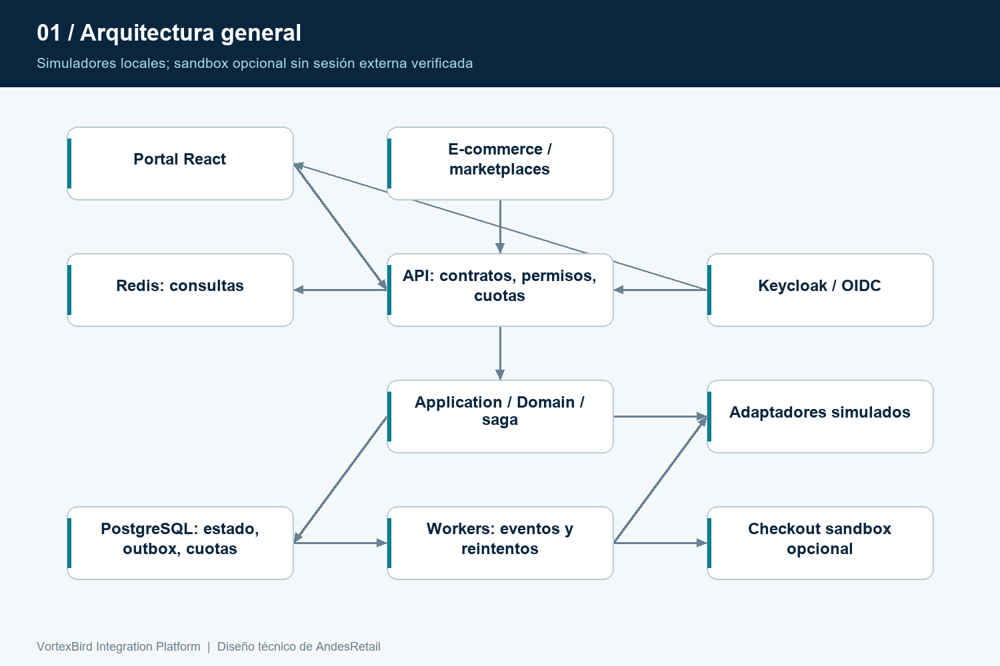
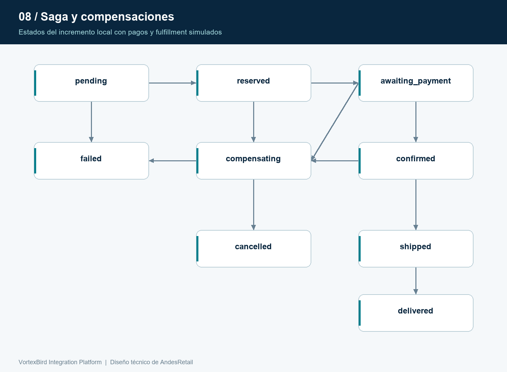

# VortexBird Integration Platform

**AndesRetail | Assessment de arquitectura senior**  
Versión de trabajo: 13 de noviembre de 2026. Autoría: propuesta técnica para sustentación.  
Fuentes de requisitos: `VB.TST.Assessment-Senior-Arq.V.1.2 (1).pdf` y `Texto pegado(5).txt`.

**Cómo leer este documento.** La arquitectura productiva es un objetivo; no constituye evidencia de un despliegue existente. La implementación local utiliza sistemas empresariales simulados, identificados como tales. Las capacidades y validaciones efectivamente terminadas se registran en `implementation-status.md`. Los objetivos 99,9% y p95 < 300 ms requieren validación operativa y de carga. Los ejemplos de liderazgo del apartado 9 son escenarios propuestos, no experiencias personales atribuidas al candidato.

## 1. Resumen ejecutivo

AndesRetail conecta ERP, WMS, OMS, CRM, e-commerce, marketplaces y pagos mediante integraciones punto a punto. Cada nuevo canal aumenta el número de dependencias, duplica reglas y hace más difícil conocer el estado real de una venta. Durante promociones, las consultas masivas compiten con las operaciones transaccionales; una indisponibilidad del ERP puede propagarse hasta el checkout. La falta de contratos y de trazabilidad común convierte una incidencia técnica en pedidos duplicados, inventario comprometido y horas de conciliación manual.

Proponemos una capa de interoperabilidad con contratos de negocio estables, adaptadores independientes y operación observable. El portal administrativo permite gestionar partners, permisos, órdenes, pagos, eventos y auditoría. El objetivo inicial es una plataforma modular operable; extraer microservicios será una decisión apoyada en carga, autonomía de equipos y límites de disponibilidad, no un requisito cosmético.

- Exponer APIs versionadas de stock, precios y órdenes con autorización por partner y canal, validadas nuevamente en los servicios.
- Aislar los modelos y protocolos de ERP, WMS, OMS y CRM detrás de adaptadores y una capa anticorrupción.
- Servir consultas de promoción desde proyecciones y Redis, con frescura explícita y límites que protejan los sistemas legados.
- Coordinar la creación de órdenes con una saga persistente: reservar, iniciar pago, confirmar o compensar, sin simular una transacción SQL distribuida.
- Persistir la idempotencia por partner y clave, para que los reintentos no creen una segunda orden ni un segundo cobro.
- Publicar cambios mediante outbox transaccional y consumidores idempotentes; reintentar fallos transitorios y aislar mensajes persistentes en DLQ.
- Centralizar identidad en Keycloak mediante OIDC, separar scopes de los permisos dinámicos de aplicación y custodiar secretos fuera de Git.
- Medir los flujos con correlation-id, trazas, métricas y auditoría, acompañados de alertas accionables y procedimientos de recuperación.
- Evolucionar hacia AWS con infraestructura declarativa y perfiles de demostración y producción, previa revisión de costos y aprobación explícita.

El beneficio de negocio es reducir duplicados y ventas inconsistentes, incorporar canales con menor cambio en los sistemas centrales y acortar la detección y recuperación de incidentes. La plataforma no elimina la consistencia eventual: la vuelve explícita, medible y reconciliable. El incremento incluye simuladores y código de checkout sandbox opcional, con evidencia de pruebas aisladas. La sesión externa de pagos, la ejecución integrada sobre PostgreSQL y los SLO aún requieren verificación. La operación productiva requiere el roadmap de 4-6 semanas, 3 meses y 6 meses descrito más adelante.

## 2. Preguntas, supuestos y riesgos

### Preguntas al cliente

| ID | Pregunta | Decisión que habilita |
| --- | --- | --- |
| Q1 | ¿Quién es la autoridad de stock vendible y cuál de inventario contable? | Evitar que ERP y WMS descuenten la misma reserva. |
| Q2 | ¿WMS soporta reservas con clave idempotente, vencimiento y consulta por referencia? | Determinar compensación y reconciliación ante timeouts. |
| Q3 | ¿Qué tráfico base, distribución por SKU y duración tiene una campaña 10x? | Dimensionar carga, hot keys, cuotas y capacidad. |
| Q4 | ¿Qué antigüedad máxima toleran stock, precios y datos de fidelización? | TTL, proyecciones y comportamiento ante datos obsoletos. |
| Q5 | ¿Quién calcula descuentos, impuestos, moneda y vigencia del precio? | Definir snapshot de precio y evitar recalcular después del cobro. |
| Q6 | ¿Un partner puede usar varios canales o tiendas? ¿Qué operaciones comparte? | Modelo de aislamiento y autorización contextual. |
| Q7 | ¿La pasarela separa autorización y captura? ¿Cómo notifica y concilia pagos? | Diseñar estados inciertos, anulación y reembolso. |
| Q8 | ¿Qué RPO, RTO y ventanas de mantenimiento se aceptan por flujo? | Estrategia de respaldos, recuperación y disponibilidad. |
| Q9 | ¿Qué protocolos, límites y SLAs ofrecen ERP, WMS, OMS y CRM? | Adaptadores, backpressure y presupuestos de timeout. |
| Q10 | ¿Qué datos personales son indispensables y cuál es su retención autorizada? | Minimización, borrado y acceso a auditoría. |
| Q11 | ¿Cómo autentican marketplaces y quién aprueba el onboarding de partners? | Client credentials, scopes, cuotas y revocación. |
| Q12 | ¿Qué equipo opera la plataforma fuera de horario y quién decide detener ventas? | Alertas, escalamiento y runbooks. |

### Supuestos de diseño que deben validarse

| ID | Supuesto | Efecto si no se cumple |
| --- | --- | --- |
| A1 | WMS es autoridad de disponibilidad física; ERP conserva la contabilidad. | Se redefine la propiedad de inventario antes de vender. |
| A2 | ERP origina catálogo y precios; la plataforma mantiene proyecciones de lectura. | Se añade un motor de precios o servicio maestro. |
| A3 | Un pedido pertenece a un partner y un canal autorizados. | Se modela división de pedidos y permisos adicionales. |
| A4 | El precio aceptado se guarda como snapshot de la orden, en COP inicialmente. | Se añaden reglas de cambio, redondeo e impuestos multimoneda. |
| A5 | Reservas expiran después de un plazo configurable; se propone 15 minutos. | Operaciones acuerda un plazo compatible con pagos diferidos. |
| A6 | Mensajes y webhooks pueden duplicarse o llegar fuera de orden. | Los consumidores nunca asumen entrega única ni orden global. |
| A7 | La pasarela admite una referencia comercial idempotente y consulta de estado. | Se bloquea el reintento ciego y se exige conciliación manual. |
| A8 | Stock de consulta admite hasta 15 s de antigüedad; precio, 60 s. | Se reduce TTL o se detienen consultas sin datos suficientemente frescos. |
| A9 | La aplicación no procesa ni almacena PAN ni CVV. | Cambia radicalmente el alcance de seguridad y cumplimiento. |
| A10 | La región inicial será us-east-2; no hay requisito confirmado de residencia. | Se reevalúan latencia, región y restricciones contractuales. |
| A11 | HTTPS y un dominio verificado estarán disponibles antes de publicar. | El entorno sigue local o privado hasta contar con TLS válido. |
| A12 | El equipo puede entregar un MVP con límites explícitos en 4-6 semanas. | Se prioriza el flujo de órdenes y se reduce administración secundaria. |

### Riesgos y tratamiento

| Riesgo | Impacto | Probabilidad | Mitigación y señal de control |
| --- | --- | --- | --- |
| Timeout después de que la pasarela aceptó un pago | Alto: doble cobro o cancelación incorrecta | Media | Estado PaymentUnknown, consulta por referencia, claves estables y conciliador; nunca cobrar otra vez para resolver incertidumbre. |
| Stock desactualizado durante un pico | Alto: sobreventa | Alta | Reservas atómicas contra autoridad, TTL explícito, invalidación y límites; medir conflictos y antigüedad. |
| Fuga de datos entre partners | Crítico | Media | Contexto derivado de identidad, filtros en todas las consultas, claves compuestas y pruebas negativas por objeto. |
| Eventos duplicados o desordenados | Alto | Alta | Inbox con índice único, versión por agregado, transiciones válidas y reconciliación. |
| Saturación de ERP/WMS | Alto | Alta | Proyecciones, caché, bulkheads, circuit breaker, cuotas y admisión controlada. |
| Dependencia central de identidad | Alto | Media | Verificación local JWT con JWKS cacheado; HA de Keycloak en producción y procedimientos de rotación. |
| Costos AWS desproporcionados para la demo | Medio | Alta | Perfil demo, presupuesto, etiquetado, inventario y aprobación del plan antes de provisionar. |
| Demostración confundida con sistema productivo | Alto | Media | Etiquetas de simulación, matriz de evidencia y puertas explícitas antes del despliegue. |

## 3. Arquitectura de alto nivel



### Componentes y propiedad

| Componente | Responsabilidad | Límite explícito |
| --- | --- | --- |
| Portal React | Operación, administración y consulta; OIDC en navegador | No autoriza por sí solo ni guarda secretos de partners. |
| API Gateway | TLS, protección de borde, cuotas, routing, límites de payload | No contiene la saga ni transformaciones del ERP. |
| API .NET | Contratos, validación, permisos/contexto y despacho de casos de uso | No confía en cabeceras de identidad arbitrarias. |
| Application/Domain | Comandos, consultas, reglas, saga y eventos de negocio | Independientes de protocolos y tablas externas. |
| Infrastructure | EF/PostgreSQL, caché, adaptadores, outbox y mensajería | Implementa puertos definidos hacia el interior. |
| PostgreSQL | Estado durable, idempotencia, reservas, historial y outbox | Su transacción termina en la base de datos local. |
| Redis | Acelerar consultas y reducir presión en legados | No es autoridad de stock ni de pagos. |
| Keycloak | Identidad, sesiones, registro, recuperación, OIDC | Los permisos de negocio dinámicos siguen en la plataforma. |
| Workers | Entregas, reintentos, conciliación y proyecciones | Toda acción externa debe soportar duplicación y recuperación. |

### Decisiones y alternativas

1. **Modularidad antes de distribución.** Clean Architecture y bounded contexts dentro del backend reducen el costo operativo del primer incremento. Separar procesos de lectura y workers permite escalar sin crear diez microservicios. Se extraerán servicios cuando haya necesidad de despliegue autónomo, aislamiento o escala independiente. Se acepta una base compartida inicialmente, con propiedad lógica de tablas.
2. **CQRS sin event sourcing.** Comandos validan invariantes; consultas agregan y paginan en PostgreSQL. El estado actual y el historial son persistentes; el log de eventos no se presenta como fuente única reconstruible. Event sourcing añadiría complejidad no justificada por este caso.
3. **Saga orquestada.** El estado del flujo se concentra en órdenes, con pasos y compensaciones visibles. Facilita explicar qué quedó reservado o pendiente. Frente a coreografía, sacrifica autonomía para ganar trazabilidad y control en un dominio pequeño.
4. **Outbox y entrega al menos una vez.** Un commit local guarda cambio y evento. El publicador puede enviar y fallar antes de marcar: habrá duplicados. Inbox/deduplicación y operaciones idempotentes son obligatorios; no se promete exactly-once end-to-end.
5. **Transporte local y SQS opcional.** El outbox usa por defecto consumo local durable. La variante SQS tiene publicador, consumidor e inbox persistente; el marshalling JSON propio se apoya en el pipeline oficial `AWSSDK.Core` para credenciales, SigV4, HTTP y retry. No se presenta como instalado el paquete generado `AWSSDK.SQS`. La ejecución AWS/ElasticMQ permanece pendiente. El contrato actual acepta eventos del propio outbox verificados por hash y partner, no un bus abierto a productores externos. Fan-out futuro requiere SNS/EventBridge o varias colas, no consumidores competidores que reciban todos el mismo evento.
6. **EKS como objetivo evaluado.** Aporta estándares Kubernetes y portabilidad, pero suma control plane, nodos, ingress y operación. Para una demo, Compose local y un perfil cloud reducido ofrecen menor costo; producción demanda HA, restauración probada y monitoreo.

### Sync versus async

| Operación | Elección | Motivo y comportamiento de fallo |
| --- | --- | --- |
| Consulta stock/precio | Síncrona con proyección y caché | El consumidor necesita respuesta rápida. Se informa frescura; datos excesivamente antiguos producen 503, no un cero ficticio. |
| Validación de token/permisos | Síncrona | No se acepta una operación esperando una autorización posterior. |
| Aceptación de orden | Síncrona hasta persistencia durable | Se entrega identidad/estado; no se exige terminar todos los sistemas antes de responder. |
| Reserva/inicio de pago | Saga; cada llamada externa acotada | Resultado inmediato si existe, estado pendiente o incierto si no; recuperación durable. |
| Notificar, CRM, proyección OMS | Asíncrona | No deben tumbar checkout; permiten reintento y conciliación. |
| Webhooks de negocio | Asíncrona, entrega durable | El receptor puede estar caído; la cola conserva intención y resultado. |
| Consultar estado de orden | Síncrona desde estado local | Expone también Pending/Unknown/Compensating; no oculta incertidumbre. |

### Contratos y transformación

El gateway valida tamaño, frecuencia y el token como defensa de borde. La API repite validación criptográfica y contextual; Application valida el caso de uso, Domain protege invariantes y cada adaptador traduce códigos, unidades y estados del proveedor. Las transformaciones no se dispersan en controladores ni en el frontend. Los DTO públicos usan `/api/v1`; un cambio aditivo compatible no obliga a v2. Cambios incompatibles requieren una nueva versión, ventana de convivencia, métricas por consumidor y fecha de retirada comunicada. Los eventos llevan tipo y versión de esquema independientes.

## 4. Diseño de la capa de interoperabilidad

### Bounded contexts y puertos

| Contexto | Propiedad | Contratos hacia otros contextos |
| --- | --- | --- |
| Identity & Access | Usuarios vinculados a OIDC, roles y permisos | Identidad y permiso efectivo; nunca contraseña del IdP. |
| Partners | Partners, canales, tiendas permitidas y cuotas | Contexto de acceso validado. |
| Catalog | SKU y categorías canónicas | Productos vendibles y versión de catálogo. |
| Inventory | Proyección, reservas y liberaciones | Disponibilidad consultable y reserva por orden. |
| Pricing | Precios por canal/cliente y vigencia | Cotización y snapshot monetario. |
| Orders | Orden, líneas, historial y saga | Estado de negocio y eventos. |
| Payments | Referencias, transacciones y conciliación | Estado de pago sin datos de tarjeta. |
| Integrations | Configuración, adaptadores y ejecuciones | Capacidades del proveedor, salud y resultados normalizados. |
| Events/Webhooks | Outbox, inbox, entrega, reintentos y DLQ | Sobre de evento versionado y firmado al entregar. |
| Audit & Observability | Evidencia de acciones y contexto | Consulta autorizada; sin escritura administrativa destructiva. |

La implementación incorpora `ErpPricingAdapter` para normalizar precios, `WmsInventoryAdapter` para consultar/reservar/liberar stock local de forma atómica, `CrmCustomerAdapter` para validar referencias de cliente y `OmsOrderAdapter` para normalizar y registrar propagación de órdenes confirmadas. Son adaptadores simulados respaldados por PostgreSQL. E-commerce y marketplaces consumen las APIs, sin acceso a tablas. `IPaymentGateway` tiene un simulador predeterminado y `MercadoPagoSandboxGateway` opcional; ambos separan la llamada de proveedor de la transacción de asentamiento. Cada guard de adaptador limita concurrencia y permite fallos inducidos. Una prueba simulada no demuestra conectividad empresarial real.

### Contratos de ejemplo

Los siguientes ejemplos corresponden a los DTO y endpoints implementados. Los UUID de partner y canal, el SKU y la tienda pertenecen al seed de demostración. El identificador de la orden y los timestamps se generan al ejecutar; no representan una transacción realizada.

**Consulta de stock**

```http
GET /api/v1/inventory/stock?sku=AND-0001&storeId=BOG-01&channelId=22222222-2222-2222-2222-222222222222
Authorization: Bearer <access_token>
X-Correlation-ID: demo-stock-001
Accept: application/json
```

```json
{
  "sku": "AND-0001",
  "storeId": "BOG-01",
  "channelId": "22222222-2222-2222-2222-222222222222",
  "onHand": 33,
  "reserved": 0,
  "available": 33,
  "asOf": "2026-11-13T15:00:00Z",
  "stale": false
}
```

La respuesta no constituye una reserva. El permiso `inventory.read` y la relación partner-canal se verifican antes de consultar; las claves de caché incluyen esas dimensiones. El seed inicial produce los valores anteriores; las órdenes los modifican. `404` indica una combinación inexistente y `403` un canal fuera del contexto. El código actual asigna `asOf` al leer la proyección local y TTL de 10 s; no mide antigüedad respecto de un WMS real. La política productiva de frescura descrita en el apartado 6 queda por completar.

**Crear orden**

```http
POST /api/v1/orders
Authorization: Bearer <access_token>
Idempotency-Key: checkout-20261113-0001
X-Correlation-ID: demo-order-001
Content-Type: application/json

{
  "partnerId": "11111111-1111-1111-1111-111111111111",
  "channelId": "22222222-2222-2222-2222-222222222222",
  "storeId": "BOG-01",
  "customerId": "CUST-001",
  "items": [{ "sku": "AND-0001", "quantity": 2 }],
  "paymentOutcome": "approved"
}
```

```json
{
  "id": "44444444-4444-4444-4444-444444444444",
  "status": "reserved",
  "currency": "COP",
  "total": 69800,
  "paymentStatus": "pending",
  "correlationId": "demo-order-001",
  "replayed": false
}
```

Se responde `202 Accepted` con `Location: /api/v1/orders/{id}` después de persistir orden, reserva y outbox. El worker inicia el proveedor configurado; consultar la orden informa la evolución. El ejemplo utiliza el simulador predeterminado. El servidor calcula precio e importe. `partnerId` es obligatorio en el cuerpo y se contrasta con el contexto autenticado; enviarlo no concede acceso. `paymentOutcome` controla exclusivamente la demostración y se ignora por el gateway externo: no permite aprobar un pago real. Repetir la clave válida devuelve el recibo original y `replayed: true`.

### Error consistente

```json
{
  "type": "urn:vortexbird:error:idempotency_conflict",
  "title": "No se pudo completar la operación",
  "status": 409,
  "detail": "La clave ya fue usada con un contenido diferente.",
  "instance": "/api/v1/orders",
  "errorCode": "idempotency_conflict",
  "correlationId": "demo-order-001",
  "timestamp": "2026-11-13T15:00:00Z",
  "validationErrors": null
}
```

Se usa `application/problem+json`, con campos base de RFC 9457 y extensiones controladas. `validationErrors` contiene detalles de entrada cuando aplica y puede ser null. No se incluyen stack traces, consultas SQL, tokens ni respuestas crudas del proveedor. En el incremento actual: `400` entrada inválida; `401` identidad no válida; `403` sin autorización; `409` conflicto de dominio o idempotencia; `429` cuota agotada con `Retry-After`; y `503` dependencia no disponible cuando corresponde. Un futuro 422 exige evolución explícita del contrato, no se presupone implementado.

### Idempotencia durable y concurrencia

La implementación usa unicidad `(partnerId, idempotencyKey)` en la tabla exclusiva de creación de órdenes; la operación es implícita. Exige una clave no vacía de hasta 128 caracteres. El hash SHA-256 incluye partner, canal, tienda, cliente, líneas ordenadas por SKU y resultado simulado. Un advisory lock transaccional PostgreSQL por partner/clave y el índice único arbitran concurrencia entre réplicas. El registro conserva hash, estado, orderId, respuesta JSON y expiración; el código HTTP del endpoint es siempre 202 para el recibo aceptado.

Para clave existente y hash distinto se devuelve conflicto. Si terminó, se reproduce el recibo sin recalcular precio, añadiendo `replayed: true`; un registro no terminado produce `idempotency_processing`. La expiración es de 24 h: el registro no se borra ni reutiliza automáticamente, y una clave vencida produce `idempotency_expired`. Esto evita duplicados tardíos. El cliente conserva la misma clave si pierde la respuesta y utiliza una nueva solo para otra operación de negocio.

La reserva implementada aplica una actualización condicional `OnHand - Reserved >= quantity`, con orden determinista de SKU, dentro de una transacción local. El handler usa los puertos CRM/ERP/WMS; sus implementaciones simuladas comparten la base local, por lo que orden, reserva, historial y outbox pueden guardarse atómicamente. El worker llama a `IPaymentGateway` fuera de transacción y luego persiste el resultado de saga. Al conectar WMS real, la reserva deberá convertirse en un paso externo persistente y reconciliable, sin mantener la transacción SQL durante una llamada de red.

### Saga y recuperación



El flujo de orden usa `pending -> reserved -> awaiting_payment -> confirmed` o `compensating -> cancelled`; admite `shipped -> delivered` después de confirmar. El worker deduplica mensajes y cancela reservas vencidas. El checkout externo tiene su propio estado: `creating`, `pending`, `unknown`, `approved`, `cancelled`, `refund_pending`, `refunded` o `manual_review`. Una respuesta incierta queda `unknown`; no se convierte en rechazo ni en una segunda creación automática. Estos caminos tienen código y pruebas de reglas/transporte controlado; la ejecución completa contra PostgreSQL y Mercado Pago sigue pendiente.

Las transiciones válidas y los bloqueos por orden evitan que una notificación antigua haga retroceder una aprobación o reembolso. El reconciliador revisa checkouts pendientes, inciertos y reembolsos. El outbox se despacha con leases o locks de filas y `SKIP LOCKED`; al publicar y fallar antes de confirmar pueden aparecer duplicados. La deduplicación de mensajes y la idempotencia del efecto externo son controles diferentes y requieren pruebas de recuperación sobre varias sesiones.

### Checkout sandbox, inbox y conciliación

El flujo opcional crea `PaymentCheckout` y `Payment` antes del POST a Mercado Pago, guardando la referencia `partnerId:orderId`, importe, moneda, vencimiento y lease. El cliente verifica la cuenta configurada y su condición `test_user` antes de crear una preferencia; el prefijo de una credencial no acredita que sea de pruebas. Un timeout deja intención durable `unknown`. La recuperación busca por referencia y verifica vendedor, importe, moneda y vencimiento: ausencia o ambigüedad no autorizan repetir el POST.

| Endpoint implementado | Contrato y control |
| --- | --- |
| `GET /api/v1/payments/orders/{orderId}/checkout` | `payments.read` y partner/canal; devuelve orderId, provider, status, checkoutUrl, expiresAt, paymentStatus y canRetry. |
| `POST /api/v1/payments/orders/{orderId}/reconcile` | `payments.manage` y partner/canal; agenda conciliación durable y responde 202, sin declarar pago aprobado. |
| `POST /api/v1/payments/mercadopago/webhook?data.id={paymentId}` | Sin JWT, con HMAC y timestamp; máximo 32 KiB; confirma recepción después de persistir inbox o encontrar duplicado durable. |
| `GET /api/v1/payments/inbox` y `POST /api/v1/payments/inbox/{id}/retry` | Operación global autorizada para inspeccionar excepciones y reprogramar recepciones agotadas. |

El frontend solo abre una URL HTTPS de checkout permitida mientras la orden está pendiente y la reserva vigente. Ni el retorno del navegador ni el contenido de una notificación confirman el pago. El worker obtiene el recurso autoritativo y comprueba `live_mode=false`, vendedor, identificador, importe, COP y referencia exactos. La clave de la inbox deriva del manifest firmado canónico; variaciones equivalentes de firma no eluden deduplicación.

Una aprobación válida consume reservas una vez. Una aprobación tardía, sin reserva o de un segundo pago crea un reembolso durable con clave estable por orden/pago y lectura posterior de confirmación. Reembolsar el segundo pago no cancela el primero aceptado. Antes del despacho, un reembolso verificado restituye inventario una vez; después del despacho/entrega queda en revisión, sin reposición automática. Los contracargos requieren revisión operativa. La política ignora estados pendientes/rechazados antiguos y no revierte un reembolso por una aprobación atrasada.

El simulador sigue siendo el valor predeterminado. Activar sandbox requiere proveedor y flag explícitos, vendedor/comprador de pruebas, secretos y URLs HTTPS accesibles. Los 61 controles de pago usan transporte HTTP controlado y reglas de producción: no acreditan una sesión externa. Configuración y límites completos: `vortexbird-backend/README-payments.md`.

## 5. Seguridad

### Flujos de identidad

En el portal se utiliza Authorization Code con PKCE S256 contra Keycloak; es un cliente público sin client secret en JavaScript. Se validan `state`, `nonce` y URI de redirección exacta mediante el cliente OIDC. Access tokens cortos permanecen en memoria; renovación, revocación y detección de reutilización de refresh tokens corresponden al proveedor de identidad. Registro, recuperación, cambio de contraseña y logout utilizan los flujos del IdP, con SMTP configurado antes de verificar recuperación por correo.

Los canales máquina a máquina usan client credentials, una identidad por partner y scopes mínimos. No comparten credenciales de un usuario humano. Para producción se prefieren credenciales rotables y, cuando el proveedor lo permita, autenticación asimétrica del cliente. Una ruta de acceso demo, si se habilita, exige entorno Development y configuración explícita; nunca sustituye OIDC en producción.

### Gateway y servicios

| Control | Gateway | Servicio |
| --- | --- | --- |
| TLS y límites de cuerpo | Terminación TLS y rechazo temprano | Conexión confiable y límite secundario. |
| JWT | Validación de borde si se configura soporte OIDC | Obligatoria: firma, algoritmo permitido, issuer, audience, exp, nbf. |
| Scopes | Filtro de ruta general | Exige scope apropiado para la acción. |
| Permisos dinámicos | No decide los permisos del negocio | Consulta roles/permisos efectivos y cuenta activa. |
| Partner/canal/objeto | Cuota por identidad validada | Verifica relación y filtra cada lectura/escritura. |
| Correlation-id | Genera o limita formato | Propaga sin tratarlo como credencial. |

Los roles son administrables; no se verifica `if role == ADMIN` en cada controlador. Una política de permiso calcula la unión efectiva de roles vigentes y aplica restricciones de partner/canal. Cambiar permisos invalida caché/versiona la política; mantener una caché sin invalidación dejaría acceso revocado durante demasiado tiempo. Roles protegidos y asignación de privilegios exigen permisos propios y auditoría. Se prohíbe escalar privilegios asignando permisos que el actor no está autorizado a delegar.

### Claves, secretos y datos

Access tokens propuestos: 5 minutos, con tolerancia de reloj máxima de 30 s. Rotar claves de firma manteniendo temporalmente la anterior en JWKS hasta expirar tokens emitidos; refrescar JWKS ante `kid` desconocido con límites para evitar abuso. Los servicios no aceptan un issuer arbitrario ni desactivan validación TLS en producción. Secrets Manager concentra contraseñas y secretos; el diseño AWS del backend utiliza EKS Pod Identity con rol acotado y asociación cluster/namespace/service account. GitHub Actions asume otro rol por OIDC, sin claves AWS permanentes. Identidad de pod, CSI y acceso real a SQS/secretos aún requieren verificación tras desplegar.

PostgreSQL permanece privado, con cifrado, backups y credenciales separadas para migraciones y runtime. Auditoría append-only desde aplicación; protección frente a administradores de base requiere controles adicionales como exportación inmutable y separación de funciones. Se registra identificador de usuario, no token; los cuerpos con PII no se copian íntegros a logs. Webhooks firman cuerpo exacto con HMAC, timestamp y deliveryId, permiten rotación de secreto, restringen ventana de tiempo y conservan protección contra replay.

### Threat model

| Amenaza | Superficie y efecto | Mitigación | Verificación |
| --- | --- | --- | --- |
| BOLA entre partners | Consultar orden ajena por UUID conocido | Filtro contextual en consultas y comandos; no confiar en partnerId del cliente | Token A contra objeto B devuelve 403/404. |
| Escalamiento de privilegios | Editar roles o asignarse permisos | Permiso de delegación, roles protegidos, revisión y auditoría | Usuario operativo no puede modificar RBAC. |
| Robo/replay de token | Navegador, logs o refresh reutilizado | PKCE, CSP, tokens breves en memoria, rotación en IdP, sin tokens en URLs/logs | Token expirado y audience incorrecta rechazados. |
| Doble cobro por reintento | Timeout o webhook repetido | Clave estable, inbox, referencia única, transición monotónica, conciliación | Repetir petición/evento conserva una transacción. |
| SSRF desde webhooks | URL elegida por partner accede metadata o red privada | Solo HTTPS, allowlist/validación DNS e IP, bloqueo privadas/link-local, sin redirects, egress limitado | Rechazar loopback, metadata y redirect a privado. |
| Saturación de legados | Promoción o cliente abusivo | Cuotas, caché, bulkheads, circuit breaker y backpressure | Carga 10x no supera concurrencia pactada. |
| Inyección y XSS | Filtros, exportaciones y campos libres | SQL parametrizado/EF, allowlist de sort, encoding, validación, CSP | Payload malicioso no ejecuta SQL/HTML. |
| Fuga de secretos/PII | Logs, repositorios y exportaciones | Redacción, gestión de secretos, acceso mínimo, retención y auditoría | Escaneo de secretos y revisión de logs/exportación. |

## 6. Resiliencia, performance y escalabilidad

### Presupuestos y admisión

El SLO es 99,9% mensual en APIs externas y p95 < 300 ms en stock/precio, bajo un perfil de tráfico acordado. El primero equivale aproximadamente a 43,2 minutos de indisponibilidad en 30 días; es un presupuesto, no disponibilidad medida. La latencia se mide desde el borde y se segmenta por ruta, caché y partner. Una prueba local corta no demuestra disponibilidad mensual ni comportamiento de producción.

La implementación utiliza ventanas fijas de un minuto y presupuestos independientes de partner y canal, configurables entre 10 y 100.000 solicitudes/minuto. `PostgresQuotaStore` comparte contadores entre réplicas: toma un advisory lock por partner, usa el reloj de PostgreSQL, comprueba todos los presupuestos y hace los UPSERT en una transacción. Si alguno se agota, no descuenta parcialmente los demás y devuelve 429 con `Retry-After` hasta el fin de la ventana. Si PostgreSQL falla, responde con indisponibilidad; no concede tráfico ilimitado como fallback.

| Solicitud | Presupuestos consumidos | Protección frente a evasión |
| --- | --- | --- |
| Recurso o canal explícito | Partner y canal del recurso | Resuelve el objeto dentro del alcance autorizado; no confía en una cabecera libre. |
| Listado agregado | Partner y todos los canales autorizados alcanzados | Omitir channelId no evita los límites; no se cargan canales ajenos. |
| Creación de orden | Partner/canal del cuerpo validado | Límite 64 KiB, UUID único por campo y rechazo de ambigüedades; el body sigue disponible para el handler. |
| Identidad y administración global | Límite aplicable al contexto, más techo exterior | No se inventa un canal a partir de X-Channel-Id; los endpoints de identidad no consumen cuotas de lectura de todos los canales. |

Una ventana fija puede permitir una ráfaga alrededor de su frontera. Token bucket o una ventana deslizante son alternativas si el perfil de promoción lo exige. La solución actual añade una operación transaccional de cuota a cada petición y serializa contadores de un mismo partner: esto protege consistencia, pero su costo y contención deben medirse antes de prometer p95. Se aprobaron 17 pruebas de planificación/parser y siete comprobaciones SQL en una sesión embebida; no se ha medido concurrencia entre réplicas Npgsql. Separar capacidad de consulta y checkout continúa siendo una decisión operativa por verificar.

### Política de caché propuesta

| Dato | Clave | TTL inicial | Invalidación y fallo |
| --- | --- | --- | --- |
| Stock de consulta | partner:canal:tienda:sku | 15 s + jitter | Cambio de inventario/reserva y versión de proyección; si supera frescura máxima, 503. |
| Precio general | partner:canal:sku:moneda | 60 s + jitter | Cambio de lista o promoción; nueva orden revalida vigencia. |
| Precio personalizado | partner:canal:cliente:sku | Máximo 30 s | Nunca compartir con otro cliente; revisar beneficio frente al costo/PII. |
| Catálogo | partner:sku:versión | 5 min | Evento de catálogo; artículo desactivado se verifica al ordenar. |
| Política de partner | partner:policyVersion | 30 s | Invalidación inmediata al cambiar permisos/canales/cuota. |

La tabla anterior es la política objetivo. El incremento cachea stock durante 10 s y cotización durante 60 s. El cliente RESP2 implementado admite TLS `rediss`, AUTH, selección de base y respuestas acotadas; fuera de Development exige TLS y contraseña si Redis está configurado. No imprime endpoint, credenciales ni respuestas sensibles. El deadline configurable es de 50 a 5.000 ms, con 1.000 ms por defecto; errores de red/protocolo/JSON producen miss y retorno a la proyección PostgreSQL, manteniendo las cuotas. La cancelación de la petición se propaga.

Cache-aside simplifica lecturas; single-flight, jitter e invalidación completa deben verificarse bajo carga. Si Redis falla, no se envía toda la demanda al ERP. La disponibilidad consultada orienta y la reserva decide. Las 32 comprobaciones del cliente cubren configuración, TLS/AUTH y protocolo en transporte controlado; no acreditan conexión a ElastiCache, failover ni rendimiento. El timestamp de la proyección local no certifica frescura respecto de WMS real.

### Integraciones y mensajería

Cada adaptador tiene timeout total, concurrencia máxima y circuit breaker independientes. Valores iniciales propuestos: lectura externa 800 ms, pago 3 s; el flujo p95 < 300 ms no debe depender de esas llamadas en cada consulta. Reintentar como máximo dos veces únicamente fallos transitorios e idempotentes, con backoff exponencial y jitter dentro del deadline global. No reintentar 4xx de negocio ni acumular retries en gateway, cliente y adaptador a la vez. Un timeout de escritura necesita consulta por referencia antes de repetición.

En `Messaging__Provider=sqs`, el publicador reclama un evento y lo marca `published` solo tras respuesta de SQS. El consumidor usa long polling de 20 s, una recepción por ciclo y visibility de 120 s por defecto. El trabajo tiene deadline menor que la visibilidad; no se declara una renovación periódica implementada. Un fallo conserva el mensaje y modifica visibilidad con backoff; mensajes venenosos no se eliminan para permitir redrive a DLQ tras cinco recepciones. En el modo `local`, el dispatcher invoca al mismo consumidor durable sin pasar por AWS.

La inbox compara evento, partner y fingerprint contra el outbox confiable antes de reclamar `(eventId, consumer)`. Leases y finalizaciones condicionadas evitan que un worker antiguo sobrescriba al nuevo. Solo después de finalizar de forma durable se elimina el mensaje SQS. Un crash entre el efecto de negocio y la finalización puede repetir el handler: cada efecto necesita idempotencia propia; no hay exactly-once. Una finalización confirmada prevalece sobre un timeout ambiguo del publicador y no retrocede a `published`.

El endpoint AWS se restringe a la región y cuenta/cola configuradas. `ServiceUrl` HTTP se permite únicamente en Development hacia el emulador autorizado; las credenciales de emulación no se usan en AWS. Se aprobaron 20 controles de orquestación y nueve del pipeline AWS Core, incluidas firmas con credenciales de sesión sintéticas y HTTP controlado. El overlay ElasticMQ y la cola/DLQ están preparados, sin ejecución externa acreditada. Un operador corrige la causa y realiza redrive gradual con permisos y cuotas; la DLQ conserva excepciones, no garantiza que terminen procesadas. Los parámetros y EKS Pod Identity deben comprobarse en el entorno desplegado.

### Plan de promociones y evidencia

1. Medir tráfico base, distribución de SKU, tasa de escrituras y latencia de dependencias; construir dataset con hot keys y cardinalidad realista.
2. Precalentar catálogo/precios populares y validar retraso de proyecciones. Preescalar réplicas y conexiones sin exceder límites de PostgreSQL ni WMS.
3. Ejecutar k6 con calentamiento, carga normal, escalón 10x, recuperación y endurance; consultas y creación concurrente se miden por separado.
4. Inyectar caída de Redis, ERP lento, timeout de pago, mensajes duplicados y reinicio de worker; medir degradación y recuperación sin pérdida de intención.
5. Vigilar p95/p99, errores, antigüedad de datos, reservas, backlog, conexiones y compensaciones; detener la prueba si amenaza sistemas reales.
6. Publicar resultados con hardware, configuración, commit, datos, duración y limitaciones; no declarar los SLO cumplidos por el solo hecho de compilar.

## 7. Observabilidad y operación

### Telemetría y auditoría

El diseño objetivo utiliza Serilog para JSON y OpenTelemetry para enlazar HTTP, base de datos y mensajes. La cobertura real del incremento se indica en `implementation-status.md`; no se presenta una dependencia ausente como telemetría desplegada. `traceparent` cruza fronteras confiables y el sobre de eventos conserva contexto; al consumir se crea un span ligado al productor. `correlationId` identifica el proceso de negocio y `traceId` la ejecución técnica. Nunca se usa correlation-id como dimensión de una métrica de alta cardinalidad.

Campos mínimos: timestamp UTC, level, service, environment, traceId, spanId, correlationId, requestId, userId pseudonimizado, partnerId, channelId, endpoint normalizado, durationMs, statusCode y errorCode. En auditoría se añaden acción, entidad, entityId, resultado, IP tratada según política y user-agent limitado. El acceso a Activity Log y exportaciones está autorizado, paginado y auditado; no existe endpoint ordinario para borrar registros.

| Métrica | Segmentación útil | Uso |
| --- | --- | --- |
| http.server.request.count / RPS | Ruta y método | Demanda y reparto de carga. |
| http.server.duration p50/p95/p99 | Ruta y código | Objetivo de latencia y cola larga. |
| http.server.errors | Familia de estado | Fallos del servicio frente a errores del cliente. |
| order.created / confirmed / cancelled | Canal y resultado | Salud del flujo y conversión técnica. |
| payment.approved / rejected / unknown | Proveedor y estado | Incertidumbre y conciliación. |
| saga.age / compensations.pending | Paso y edad | Flujos estancados. |
| outbox.pending / oldest_age | Tipo de evento | Retraso de publicación. |
| queue.visible / oldest_age / dlq.count | Cola | Backpressure y mensajes fallidos. |
| integration.duration / errors | Sistema y operación | Presupuesto de dependencias. |
| cache.hit / miss / unavailable | Tipo de dato | Eficacia y degradación. |
| projection.age | Catálogo, stock y precio | Frescura útil al negocio. |
| db.connections / query.duration | Pool y consulta normalizada | Saturación de persistencia. |
| webhook.success / retries | Resultado, sin URL sensible | Entregabilidad. |
| inventory.reservation.conflict | Tienda/canal | Sobreventa evitada y presión de stock. |
| process.cpu / memory / restarts | Servicio/réplica | Capacidad y estabilidad. |

### Alertas propuestas

| Señal | Umbral inicial | Acción y responsable |
| --- | --- | --- |
| 5xx externos | > 2% durante 5 min, mínimo de tráfico | Guardia revisa trazas y último despliegue; evaluar rollback. |
| p95 stock/precio | > 300 ms durante 10 min | Revisar cache hit, pool y proyección; limitar admisión. |
| Stock/precio sin frescura | Edad mayor al máximo acordado | Operaciones decide degradación o suspensión por canal. |
| DLQ o outbox antiguo | DLQ > 0 o oldest > 5 min | Integraciones identifica causa; redrive tras corrección. |
| Conexiones DB | > 80% del presupuesto durante 10 min | Reducir concurrencia, revisar queries; no aumentar pools a ciegas. |
| Pago desconocido | > 0 por más de 5 min | Conciliación por referencia; escalar a proveedor sin recobrar. |
| Error webhook | > 10% durante 15 min | Contactar operación del partner y proteger cola de otros tenants. |
| Compensación pendiente | > 10 min | Liberación/reembolso supervisado con evidencia idempotente. |

Los umbrales son iniciales y requieren ajuste con tráfico real. Se usan ventanas y volumen mínimo para evitar alertas por una única muestra. Alarmas accionables incluyen dashboard, trace ejemplar, último cambio, propietario y runbook.

### Runbook: falla de stock o precio

1. Confirmar alcance por canal, partner y ruta; revisar disponibilidad, frescura y correlation-id de una petición fallida. Distinguir datos inexistentes de dependencia caída.
2. Verificar Redis, proyección PostgreSQL y conectividad del adaptador. Si la caché cayó, activar el camino acotado a proyección; no abrir acceso ilimitado al ERP.
3. Mantener circuit breaker abierto si el legado está saturado y reducir cuota temporal con autorización operativa. No reintentar masivamente ni hacer redrive durante la caída.
4. Servir datos solo dentro de frescura acordada. Fuera de ese límite, devolver 503 y mensaje útil. Deshabilitar checkout afectado si no se puede validar precio o reservar.
5. Verificar pedidos/pagos ya aceptados y no ejecutar cancelaciones masivas ante estados desconocidos; conciliar por referencia y vigilar expiración de reservas.
6. Recuperar gradualmente, refrescar proyecciones, cerrar circuito en half-open y drenar colas con límite. Validar consistencia antes de levantar cuotas.
7. Registrar tiempos, impacto, causa y acciones. Crear postmortem sin culpabilizar y una prueba de regresión que reproduzca el incidente.

## 8. Plan de implementación

### Evidencia y límites del incremento actual

`implementation-status.md` y `acceptance-checklist.md` mantienen evidencia por repositorio y por criterio. No se aprueba ni ejecuta infraestructura facturable desde este documento. Los diagramas distinguen implementación local y arquitectura objetivo; un recurso dibujado no equivale a uno desplegado. Credenciales de prueba de Mercado Pago, dominio/TLS, acceso AWS y publicación GitHub deben verificarse. El plan de infraestructura prepara perfiles demo/producción y un presupuesto provisional, sujeto al cálculo regional y aprobación: ver `vortexbird-infrastructure/costs-and-approval.md` para el detalle vigente.

### MVP de 4-6 semanas

| Semana | Entrega | Dependencia / aceptación |
| --- | --- | --- |
| 1 | Contratos, ADR, modelo de propiedad, OIDC y esqueleto CI | Cliente valida Q1-Q8; token inválido y acceso cruzado rechazados. |
| 2 | Proyecciones catálogo/stock/precio y adaptadores iniciales | Contratos de ERP/WMS; frescura y límites visibles. |
| 3 | Orden idempotente, reserva y saga de pago sandbox | Reintentos concurrentes crean una sola orden; compensación reproducible. |
| 4 | Outbox, webhooks, auditoría, dashboard y runbooks | Reinicio de worker no pierde intención; reentrega no duplica efecto. |
| 5 | Carga, seguridad y recuperación; infraestructura staging | Resultados publicados, restauración probada, costos aprobados. |
| 6 | Piloto por partner y soporte de operación | Checklist de salida, observación y rollback acordados. |

Incluye un canal principal, una integración por sistema prioritario, un proveedor de pagos en sandbox, administración básica y operación observable. Excluye multirregión, reglas fiscales internacionales, motor promocional completo, conectores ilimitados, recomendación con IA y promesas de cero indisponibilidad. Entregables: código, contratos, pipelines, infraestructura, diagramas, evidencia de pruebas y guía operativa. La salida a producción depende de aprobación de negocio, seguridad y operación, además de una compilación exitosa.

### Horizonte de 3 meses

Conectar proveedores reales mediante contratos y pruebas de proveedor; endurecer idempotencia y reconciliación con incidencias observadas; completar onboarding de partners, administración de secretos y webhooks; automatizar despliegues graduales y rollback; configurar backups y restauración ensayada; realizar pruebas de carga representativas y ajustar SLO/error budgets. Separar workers y API según escala, agregar límites distribuidos y verificar HA de identidad. Operación recibe dashboards y simulacros, no solo un manual.

### Horizonte de 6 meses

Extender catálogo de adaptadores y gobierno de APIs; introducir compatibilidad verificable de contratos, autoservicio de partners con aprobación y rotación automatizada. Extraer contextos cuando reduzca riesgos concretos, optimizar particionamiento/retención de auditoría según volumen y evaluar un bus de eventos para fan-out. Mejorar recuperación regional de acuerdo con RPO/RTO aprobados; medir costo por mil consultas y por orden completada. El roadmap se reprioriza con resultados del piloto, no se convierte en un compromiso fijo sin datos.

### Calidad, repositorios y despliegue

Se conservan cuatro repositorios independientes conforme a las áreas enumeradas en la petición. GitHub Actions valida cada uno; despliegues por OIDC y ambientes protegidos, con migraciones controladas y estrategia expand/contract. Ramas y commits se detallan en los README.

## 9. Cultura y liderazgo técnico

### 1. Ambigüedad: reducir riesgo sin frenar avance

Si el cliente no sabe si ERP o WMS reserva stock, no reparto esa decisión entre desarrolladores. Reúno a operación y responsables de ambos sistemas con un pedido real y sus estados, documento Q1/Q2 y construyo una prueba acotada de reserva, repetición y timeout. Mientras se confirma el dueño, el equipo avanza con el puerto `IInventoryAdapter` y un simulador explícito. Pongo una fecha y un responsable para cerrar el supuesto; si la capacidad externa no existe, cambio el alcance antes de prometer consistencia imposible.

### 2. Documentar decisiones para escalar el equipo

Para elegir saga orquestada sobre coreografía, escribo un ADR breve con contexto, alternativas, decisión, consecuencias y condición de revisión. Lo acompaño de una secuencia de fallo de pago y una prueba de contrato. En onboarding, una persona nueva sigue una orden por correlation-id y explica la compensación. Si el documento no permite entender o modificar el sistema, lo simplifico y conecto con código y pruebas en lugar de producir diagramas aislados.

### 3. Rapidez versus seguridad y operación

Ante una campaña cercana, negocio pide integrar dos marketplaces más. Presento opciones concretas: lanzar uno con cuotas conservadoras, sandbox validado, alertas y rollback, o posponer ambos hasta completar conciliación. No negocio aislamiento entre partners ni manejo de pagos; sí puedo diferir gráficas secundarias y autoservicio. Registro el riesgo residual con un propietario y fecha, y fijo señales de parada. La conversación usa impacto en ventas y recuperación, no únicamente complejidad técnica.

### 4. Desacuerdos técnicos fuertes

Si dos líderes proponen EKS y ECS, alineo primero criterios: capacidad operativa, costo, portabilidad requerida y tiempo de recuperación. Cada opción realiza el mismo pequeño despliegue y rollback, con un presupuesto de tiempo. Revisamos evidencia y elegimos con un responsable claro, registrando la alternativa descartada y cuándo reevaluarla. Evito una votación sobre preferencias; una vez tomada la decisión, se ejecuta de forma coherente y se revisa si cambian los hechos.

### 5. Calidad sin ralentizar el delivery

Priorizaría pruebas en las fronteras donde un fallo cuesta dinero: reserva concurrente, idempotencia, acceso cruzado, webhook repetido y recuperación tras caída. No exijo la misma profundidad a un cambio de espaciado. Contratos versionados, analizadores y CI rápido detectan problemas temprano; las pruebas lentas de carga y restauración se ejecutan en entornos dedicados. Reservo capacidad para resolver causas recurrentes y uso incidentes para mejorar controles, sin convertir cada despliegue en una reunión manual.

### Referencias técnicas y artefactos relacionados

Estas referencias apoyan las decisiones; los parámetros operativos concretos son propuestas que deben validarse:

- Plataforma e identidad: [soporte .NET](https://dotnet.microsoft.com/en-us/platform/support/policy) y [Keycloak/PKCE](https://www.keycloak.org/securing-apps/javascript-adapter).
- Contratos y persistencia: [RFC 9457](https://www.rfc-editor.org/rfc/rfc9457.html), [bloqueo PostgreSQL](https://www.postgresql.org/docs/current/explicit-locking.html) y [SELECT](https://www.postgresql.org/docs/current/sql-select.html).
- Proveedores: [SQS visibility](https://docs.aws.amazon.com/AWSSimpleQueueService/latest/SQSDeveloperGuide/sqs-visibility-timeout.html), [SQS/DLQ](https://aws.amazon.com/sqs/faqs/), [cuentas de prueba Mercado Pago](https://www.mercadopago.com.co/developers/es/docs/checkout-pro-preferences/test-accounts), [preferencias](https://www.mercadopago.com.co/developers/en/reference/online-payments/checkout-pro-preferences/create-preference/post) y [notificaciones](https://www.mercadopago.com.co/developers/es/docs/checkout-pro-orders/resources/notifications/webhooks).
